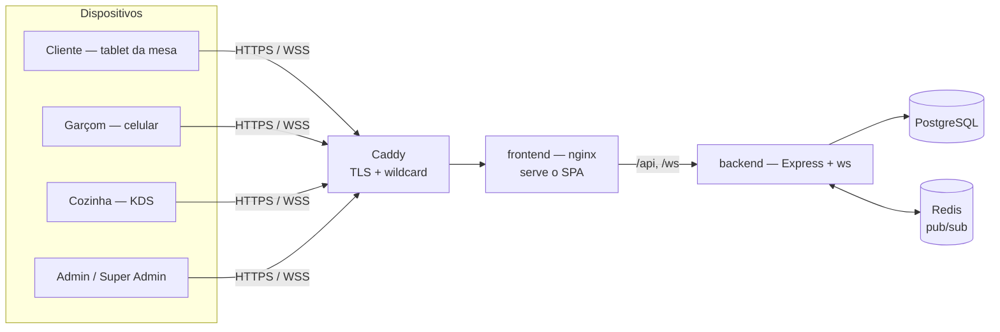
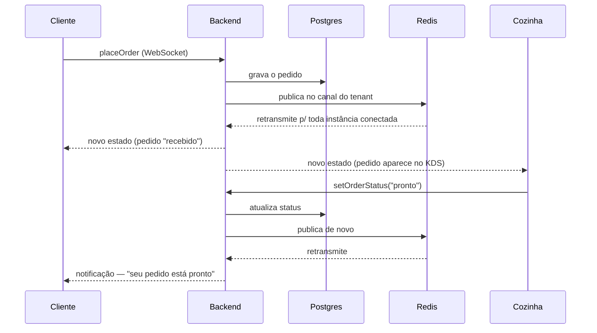

# Arquitetura — Meu Restaurante

Este documento explica a aplicação como um todo: o que cada peça do stack faz, por que foi escolhida (não só "o quê", mas "por quê"), e fecha com uma proposta de arquitetura alternativa pensada pra custo variar conforme o uso. Ele não substitui os outros documentos do projeto — [PRD.md](./PRD.md) descreve o produto, [PRD_multiclientes.md](./PRD_multiclientes.md) o modelo multi-tenant, e [AWS_DEPLOYMENT.md](./AWS_DEPLOYMENT.md) o passo a passo de implantação. Este aqui é o "mapa geral": como as peças se encaixam e por que cada uma está aí.

## Sumário

1. [Visão geral](#1-visão-geral)
2. [Fluxo de um pedido, ponta a ponta](#2-fluxo-de-um-pedido-ponta-a-ponta)
3. [Por que cada tecnologia](#3-por-que-cada-tecnologia)
4. [Arquitetura de implantação hoje](#4-arquitetura-de-implantação-hoje)
5. [Segurança](#5-segurança)
6. [Proposta: arquitetura orientada a consumo (pague pelo uso)](#6-proposta-arquitetura-orientada-a-consumo-pague-pelo-uso)

---

## 1. Visão geral

A aplicação é uma plataforma de pedidos para restaurantes/bares, multi-tenant (vários clientes, mesma aplicação, dados isolados — ver `PRD_multiclientes.md`). Cinco perfis de uso:

- **Cliente** — pede pelo cardápio digital, acompanha o status em tempo real, fecha a conta.
- **Garçom** — mapa de mesas, lança pedido, fecha conta.
- **Cozinha** — painel (KDS) que avança o status de cada pedido.
- **Admin do restaurante** — gerencia cardápio, equipe e relatórios do seu próprio cliente.
- **Super Admin** — gerencia os clientes da plataforma (cadastro, suspensão, branding).

## 2. Fluxo de um pedido, ponta a ponta

Esse ciclo — ação de um cliente vira estado persistido e aparece instantaneamente nas telas certas, de qualquer outro cliente conectado àquele mesmo restaurante — é o motivo de quase toda escolha técnica da seção 3.

## 3. Por que cada tecnologia

### Tempo real: WebSocket (`ws`)

O produto depende de atualização instantânea — um pedido lançado pelo garçom precisa aparecer na cozinha sem o funcionário dar refresh, e o cliente precisa ver quando o prato fica pronto. **Polling** (perguntar "mudou algo?" a cada N segundos) adicionaria atraso perceptível e tráfego desnecessário; **Server-Sent Events** resolveria metade do problema mas só manda dados num sentido — aqui o cliente também *envia* ações (pedir, chamar garçom). WebSocket é bidirecional e de baixa latência, o encaixe natural. Cada conexão é amarrada ao tenant resolvido no momento da conexão (`server/src/index.ts`), e todo broadcast já sai filtrado por esse tenant.

### Fan-out entre instâncias: Redis (`ioredis`)

Problema que o Redis resolve: se o backend um dia rodar em mais de uma instância (ex. atrás de um load balancer), uma mudança feita numa instância precisa chegar aos clientes conectados em *outra*. `server/src/redis.ts` usa duas conexões — uma só pra publicar, outra só pra assinar, porque "ioredis puts a connection that has called (p)SUBSCRIBE into a special mode where it can no longer run other commands, so publishing and subscribing each need their own client" — e um canal por tenant (`mesa-viva:broadcast:<tenantId>`), assinado via `psubscribe` num padrão só, o que "lets state changes fan out correctly across multiple backend instances... and... keeps one client's data from ever reaching another client's connected browsers." Hoje a aplicação roda numa única instância (ver seção 4), então o Redis não está em uso crítico agora — mas já deixa o caminho pronto pra isso mudar sem reescrever nada, e o custo de mantê-lo (um container a mais) é zero.

### Autenticação: JWT (`jsonwebtoken`) + `bcryptjs`

Sessão sem estado: o próprio token carrega a prova de login (assinada), então qualquer instância do backend valida sozinha, sem compartilhar sessão em memória — "survives restarts and scales to multiple instances behind a load balancer" (`server/src/auth.ts`). Cada token de equipe carrega o `tenantId` junto com o papel (admin/garçom/cozinha), e toda ação confere os dois — não só "é admin", mas "é admin *deste* tenant". Senhas nunca ficam em texto puro: `bcryptjs` faz o hash (escolhido em vez do `bcrypt` nativo especificamente por não exigir compilação nativa, o que causava problemas de build no Windows).

### Banco de dados: PostgreSQL + Prisma

Dado relacional de verdade — mesas, pedidos, contas, fidelidade, avaliações — com integridade referencial entre eles (um pedido pertence a uma mesa que pertence a um tenant). Prisma dá migrations versionadas (`server/prisma/migrations/`) e tipagem gerada a partir do schema, combinando com o resto do backend em TypeScript. Toda subida de container roda `prisma migrate deploy` antes de iniciar o servidor (`server/Dockerfile`) — aplica qualquer migration pendente automaticamente, sem passo manual.

### Multi-tenancy: subdomínio + coluna `tenant_id`

Cada cliente vive em `<slug>.<domínio>` (`server/src/tenant.ts` resolve isso a partir do `Host` da requisição). Os dados de todos os clientes ficam no mesmo banco, isolados por uma coluna `tenant_id` em cada tabela operacional, em vez de um banco físico separado por cliente — decisão documentada com a tabela de trade-off completa em `PRD_multiclientes.md` (seção 2.4): mais simples de operar, custo de infraestrutura não cresce por cliente novo, ao custo de depender de disciplina de código (mitigado com uma Prisma Client Extension que já injeta o filtro automaticamente).

### Frontend: React + TypeScript + Vite + Tailwind v4 + Zustand + React Router + lucide-react

- **React + TypeScript** — tipagem ponta a ponta com o backend (os tipos de `Order`, `Bill` etc. espelham o schema do Prisma).
- **Vite** — build e dev server rápidos; o bundle de produção sai pequeno o bastante pra ser servido direto por um nginx simples, sem precisar de CDN pra funcionar bem.
- **Tailwind CSS v4** — o tema único e escuro da aplicação é inteiramente tokens CSS (`--accent`, `--copper` etc.), reaproveitados também pro branding dinâmico de cada cliente (logo + cor fazem parte do cadastro do tenant).
- **Zustand** — estado do app sincronizado diretamente com as mensagens que chegam pelo WebSocket (`useRestaurantStore`, `useMenuStore`...), sem a cerimônia de um Redux pra esse tamanho de estado.
- **React Router** — rotas por perfil (`/garcom`, `/cozinha`, `/admin`, `/mesa/:id`), cada uma protegida pelo papel certo.
- **lucide-react** — ícones consistentes em toda a interface.

### Mapas: Leaflet + Nominatim

O cadastro de cliente permite marcar a localização clicando num mapa, e visualizar num mapa salvo. Em vez de depender de uma chave paga do Google Maps, o picker interativo usa **Leaflet** (OpenStreetMap, gratuito) — com um detalhe técnico registrado em `src/components/MapPickerModal.tsx`: o ícone do pino é um SVG inline via `divIcon`, não a imagem padrão do pacote, porque "the default marker images resolve to the wrong URL after webpack/Vite processes the package" — um problema clássico de Leaflet dentro de um bundler. A busca de endereço (geocodificação) usa **Nominatim**, o serviço gratuito do próprio OpenStreetMap; `server/src/geocode.ts` identifica a aplicação via `User-Agent` porque é isso que a política de uso do Nominatim exige.

### E-mail: `nodemailer`

Envia as credenciais de acesso quando um cliente novo é cadastrado (ou tem a senha redefinida). Provider-agnóstico via variáveis de ambiente SMTP genéricas — funciona com qualquer provedor (Gmail, SES, SendGrid...) sem acoplar a um específico — e, se `SMTP_HOST` não estiver configurado, cai graciosamente pra só logar o e-mail no console, o que mantém o ambiente de desenvolvimento 100% funcional sem precisar de credenciais reais.

### Upload de arquivos: `multer`

Recebe o upload da logo de cada cliente no painel Super Admin, salva em disco (servido estaticamente pelo backend) e valida o tipo de imagem no servidor — rejeitando SVG de propósito, já que esse formato pode carregar `<script>` embutido.

### Containerização: Docker + Docker Compose

A mesma peça central de toda a infraestrutura: **o `docker-compose.yml` que roda localmente é literalmente o mesmo que roda em produção** (ver seção 4) — zero diferença de comportamento entre "funciona na minha máquina" e "funciona no servidor", porque é a mesma máquina virtual, só que hospedada em outro lugar.

### nginx (container `frontend`)

Serve o build estático do React e faz proxy interno de `/api` e `/ws` pro container do backend — "so the whole app is reachable through this single port/origin — no matter how that origin is reached (LAN IP, localhost, an ngrok tunnel, ...)" (`nginx.conf`). É essa decisão que permite ao frontend sempre chamar `/api`/`/ws` como caminho relativo, sem precisar saber de antemão qual vai ser o domínio final.

### Caddy (produção)

Faz o que o nginx local não faz: terminar HTTPS. A exigência específica aqui é o certificado **wildcard** (`*.<domínio>`) — cada cliente novo ganha um subdomínio automaticamente, sem poder esperar por um certificado manual a cada cadastro. O Caddy emite e renova esse certificado sozinho via desafio DNS no Cloudflare, autenticando com um token de API escopado só a essa zona de DNS — nunca toca o resto da conta AWS (o Lightsail não tem IAM Instance Role, então não dava pra repetir o truque de "a instância se autentica sozinha" que uma EC2 permitiria; trocar o provedor DNS pro Cloudflare foi a forma de continuar sem guardar uma chave AWS de escopo amplo na máquina). A imagem oficial do Caddy não inclui esse plugin de DNS, por isso `infra/caddy/Dockerfile` faz um build customizado via `xcaddy` especificamente para adicionar o provider `cloudflare`.

### AWS CDK

Infraestrutura como código na mesma linguagem do resto do projeto (TypeScript) — a infra inteira de produção é um único stack, `infra/lib/platform-stack.ts` (ver seção 4).

## 4. Arquitetura de implantação hoje

Uma única instância Lightsail roda os mesmos containers do ambiente local (Postgres, Redis, backend, frontend) mais o Caddy na frente. Para até ~10 clientes pequenos, essa única máquina já é suficiente — WebSocket e volume de pedidos desse porte são leves, e não há necessidade de escalar automaticamente. O raciocínio completo de cada serviço escolhido (e removido) está em [AWS_DEPLOYMENT.md](./AWS_DEPLOYMENT.md#1-o-que-vai-para-o-ar-e-por-quê-cada-peça); o custo estimado de hoje (em USD e BRL) está na seção 2 do mesmo documento.

## 5. Segurança

- **Isolamento entre clientes**: todo token de equipe carrega o `tenantId`, verificado em toda ação — um token válido para o restaurante A nunca passa como válido pro restaurante B, mesmo que o nome de usuário coincida. Toda consulta ao banco é filtrada por `tenantId`.
- **Senhas com hash** (`bcryptjs`), nunca em texto puro — nem no banco, nem em log.
- **Segredos fora do git**: JWT secret, senha do banco, credenciais SMTP vivem num `.env` colocado manualmente na instância (permissão `600`), nunca commitados — o Lightsail não tem IAM Instance Role, então não há um cofre de segredos gerenciado (tipo SSM) que a própria instância leia sozinha sem alguma credencial fixa; manter o `.env` só localmente evita precisar de uma.
- **Única credencial AWS que existe na infraestrutura**: um usuário IAM com permissão apenas para gravar no bucket S3 de backup — nada além disso, nem leitura, nem outros recursos.
- **Painel da plataforma (Super Admin) é um papel à parte**, sem pertencer a nenhum tenant — isolado do sistema de login de cada cliente.

## 6. Proposta: arquitetura orientada a consumo (pague pelo uso)

A arquitetura de hoje (seção 4) cobra um valor **fixo por mês**, 24 horas por dia, independente de quanto a plataforma é realmente usada — de madrugada, com todo mundo fechado, você paga o mesmo que no horário de pico do jantar. Esta seção desenha uma alternativa onde boa parte do custo **acompanha o uso de verdade**, e termina com uma recomendação honesta de quando ela compensa.

| Camada hoje | Proposta (paga pelo uso) | O que muda |
|---|---|---|
| Frontend (nginx na instância) | **S3 + CloudFront** | Sem mudança de código — é só onde o build do Vite é publicado. Já escala a custo zero sozinho quando ninguém está navegando. |
| API REST (Express na instância) | **API Gateway (HTTP API) + Lambda**, rodando o mesmo Express via *Lambda Web Adapter* (ferramenta oficial da AWS) | Mudança pequena — as rotas continuam as mesmas, só o jeito de hospedar o processo muda. Cobra por requisição, não por hora ligada. |
| WebSocket (`ws` + Redis na instância) | **API Gateway WebSocket API + Lambda + DynamoDB** (tabela com `tenantId` + id de conexão) | **A parte que exige reescrita de verdade.** Hoje a conexão fica aberta em memória no processo, e o Redis existe pra replicar entre instâncias. No modelo serverless não existe "instância": cada mensagem é uma invocação isolada, e saber quem está conectado passa a morar no DynamoDB em vez da memória do processo — o que, por sinal, torna o Redis desnecessário (a própria AWS já centraliza isso). É o componente de maior esforço de todo esse desenho. |
| Banco (Postgres em container) | **Opção A — Aurora Serverless v2**: mesmo Postgres, mesmo Prisma, zero reescrita do schema ou das queries. **Opção B — DynamoDB**: paga só pelo que usa de verdade (com uma camada gratuita generosa), mas exige reescrever toda a camada de dados (`server/src/*Store.ts` inteiro, sem mais consultas relacionais). | A Opção A tem um **piso de custo**: mesmo parado, o Aurora Serverless v2 cobra por uma capacidade mínima sempre ligada (hoje, grosso modo, a partir de ~40 USD/mês) — ou seja, só "acompanha o uso" *acima* desse piso. A Opção B é a única genuinamente zero em repouso, ao custo da maior reescrita do projeto inteiro. |
| Upload de logo (disco local) | **S3 direto** | Mudança pequena e natural nesse modelo — já ficaria pronto pra ser servido via CloudFront também. |

### Veredito

Pra até ~10 clientes com uso normal (não ocioso na maior parte do tempo), a instância Lightsail única (já documentada em `AWS_DEPLOYMENT.md`, na faixa de 12-16 USD/mês) tende a continuar **mais barata e não exige reescrever nada**. A arquitetura por consumo desta seção só paga a pena quando o tráfego é genuinamente irregular — picos curtos, longos períodos ociosos reais, não só "de madrugada" — e aceitando dois custos de engenharia: reescrever o WebSocket (médio/alto esforço, sempre necessário nesse modelo) e, se o objetivo for zerar de vez o custo do banco também, reescrever toda a camada de dados para DynamoDB (o maior esforço de todos, praticamente um projeto novo do zero na parte de persistência).

Não é uma recomendação de "não fazer nunca" — é um mapa de quanto custa fazer, pra decidir com os números reais na mesa quando a plataforma crescer o bastante pra essa conta fechar a favor do serverless.
